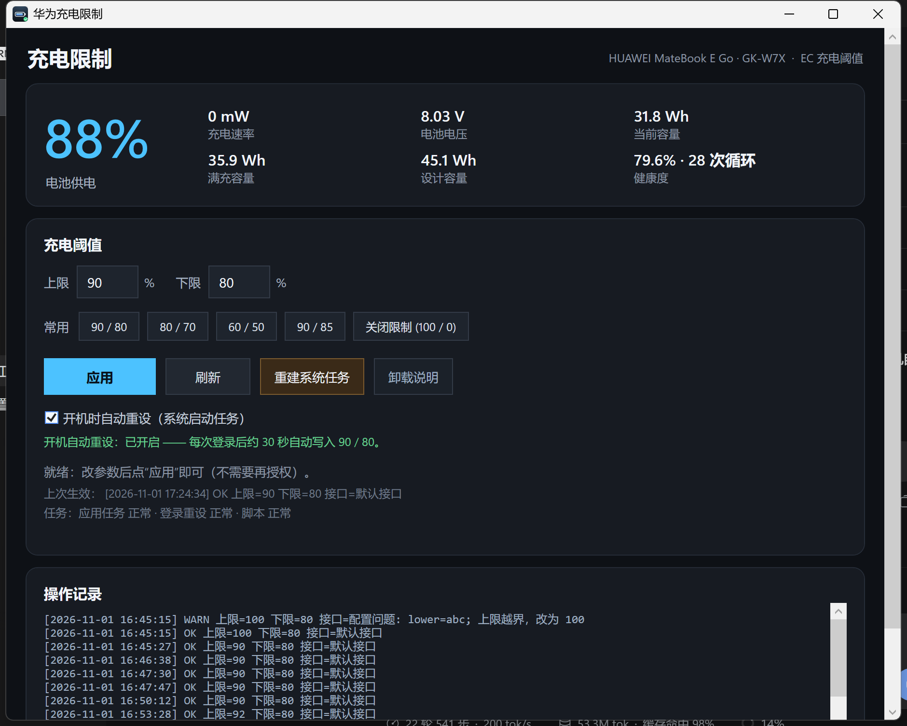
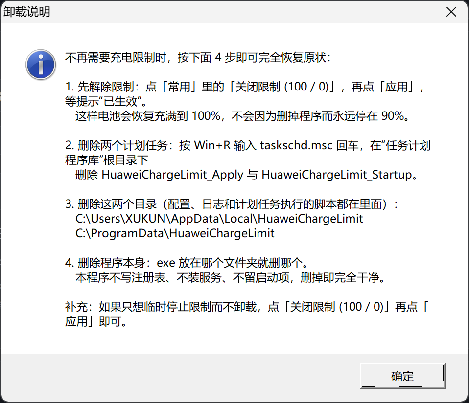

# 华为充电限制（Huawei Charge Limit）

[](https://github.com/SZTMBABY/huawei-charge-limit/releases/latest)
[](#适用机型)
[](LICENSE)

给**没有"智能充电/充电阈值"选项的华为 MateBook**（尤其高通 SoC 机型）补上 Windows 端的充电上限设置：插着电也就充到 90%（或任意 50~100%），掉到下限以下才补电，减缓长期插电造成的电池老化。



- 单文件 WPF 程序，**零安装、零运行时依赖**（用系统自带的 .NET Framework 4.x）
- 首次点一次「初始化」过 UAC，之后改阈值**完全免 UAC**
- **登录自动重设**：开机/注销后 30 秒自动把阈值写回，抵消硬复位、断电导致的清空
- 健康状态可见：任务状态、脚本版本、上次生效、失败原因一目了然
- 便携：数据全部在 `%LOCALAPPDATA%`，exe 放哪都能用
- 界面内置「卸载说明」按钮：一键弹出完整卸载步骤（含任务名与两个目录的真实路径）

## 下载

到 [Releases](https://github.com/SZTMBABY/huawei-charge-limit/releases/latest) 下载 `HuaweiChargeLimit.exe`（即「充电限制工具」，单文件，不需要安装）。首次运行若被 SmartScreen 拦截，点「更多信息 → 仍要运行」。

Release 里另附 `SHA256SUMS.txt` 校验和；介意未签名 exe 的话，可以直接用 `源码\build.ps1` 自己编译比对（见「构建」）。

> 本项目**不是**华为官方软件，与华为公司无关。使用风险自负，详见「风险与免责」。

---

## 适用机型

| 机型 | 状态 |
|---|---|
| HUAWEI MateBook E Go 2023（GK-W7X，Qualcomm sc8280xp） | ✅ 实测通过（Windows 11 ARM64 26100，BIOS 2.16） |

理论上凡是设备树里存在 `ACPI\PNP0C14\HWMI` 设备的华为消费本都适用（华为 PC Manager 的"智能充电"走的就是同一接口）。判断方法：设备管理器 → 系统设备里找 `HWMI` 设备，或在 PowerShell 里执行：

```powershell
Get-PnpDevice -InstanceId 'ACPI\PNP0C14\HWMI*'
```

**前提**：机器必须能用华为电脑管家的"智能充电"（华为官网有支持机型列表）。不支持该功能的机型，写到 EC 的阈值不会起作用。

## 原理

华为消费本把充电阈值做成了一个 WMI 方法：

| 项目 | 值 |
|---|---|
| 命名空间 / 类 | `root\wmi` / `OemWMIMethod` |
| 方法 | `OemWMIfun` |
| 实例 | `OemWMIMethod.InstanceName = 'ACPI\PNP0C14\HWMI_0'` |
| 入参 | `u8Input`，长度 64 的 `SAFEARRAY(VT_UI1)`，只有前 4~6 字节有意义 |
| 出参 | `u8Output`（首字节 `0` 表示 EC 接受） |

数据按**小端字节序**写入（下面 `u`=上限，`l`=下限）：

```
默认接口（旧格式）: 03 10 l  u  其余补 0     ← 数值 (u<<24 | l<<16 | 0x1003) 的小端表示
新接口（--new）  : 03 15 01 48 l  u          ← 数值 (u<<40 | l<<32 | 0x48011503) 的小端表示
```

- 上限 = 停止充电的电量，下限 = 重新开始充电的电量（例如 90 / 80）。
- 关闭限制 = `u=100, l=0`，即恢复充满。
- 不同 BIOS 世代接受不同格式，本程序**两条通道都试**，还额外内置两条兜底通道（见下）。

**为什么需要"登录自动重设"**：这个阈值写在 EC 的运行时参数里，**不跨硬复位/断电保存**（SoC 看门狗复位、长按电源、BIOS 升级都可能清掉；Linux 上的 `huawei-wmi`、KDE Powerdevil 也都是每次开机重写）。程序用"登录触发 + 30 秒延迟"的计划任务把它补回去。

### 四条写入通道（优先级从高到低）

1. **进程内 WMI**（System.Management 直接调 `OemWMIfun`）
2. **PowerShell 通道**（`-EncodedCommand` 里用 `Get-WmiObject` 调同一个方法）
3. **新格式重试**（上面的 `--new` 格式）
4. **上游工具兜底**（第三方 `HuaweiBatteryControl-ARM64.exe`，可选）

任一条返回 `u8Output[0] == 0` 即视为成功，日志里会记录实际走的那条通道。

## 使用

1. 双击 `充电限制工具.exe`。
2. 设上限/下限（或点「90 / 80」等常用档位），点「**初始化**」→ 在 UAC 弹窗点"是"（**只有这一次**）。
3. 之后改参数点「**应用**」即可，不再需要管理员权限。
4. 想开机自动补阈值，保持「开机时自动重设（系统启动任务）」勾选（对应 `配置.ini` 里的 `auto=1`）。

常用档位含义：

| 档位 | 适合场景 |
|---|---|
| 90 / 80 | 日常插电办公，兼顾续航与寿命（推荐） |
| 80 / 70 | 长期插电当台式机用 |
| 60 / 50 | 极端保守（长期存放/展示机） |
| 90 / 85 | 需要满电前先冲到 90 再补 |
| 关闭限制 (100 / 0) | 出门前想充满，或彻底卸载前恢复默认 |

### 文件与数据在哪

| 内容 | 路径 | 权限 |
|---|---|---|
| 程序（单文件） | 你放的位置，例如桌面 | 用户 |
| 配置 / 日志 / 自检结果 / 失败详情 | `%LOCALAPPDATA%\HuaweiChargeLimit\` | 当前用户 |
| 计划任务实际执行的脚本 | `%ProgramData%\HuaweiChargeLimit\应用阈值.ps1` | 用户只读，管理员可写 |
| 计划任务 | `HuaweiChargeLimit_Apply`（按需）、`HuaweiChargeLimit_Startup`（登录触发） | 需管理员 |

### 自检 / 排错

```cmd
充电限制工具.exe --selftest     :: 写自检结果.txt，健康时返回 0，不健康返回 1
充电限制工具.exe --apply 85 75  :: 命令行直接应用（需管理员）
充电限制工具.exe --apply-config :: 按 配置.ini 应用（计划任务用）
充电限制工具.exe --setup        :: 重建任务 + 重写脚本 + 立即应用（需管理员）
```

界面状态行里会显示三项状态：`应用任务`、`登录重设`、`脚本`。出现 `缺失`/`被禁用`/`已过期` 时点「修复系统任务和脚本」。

### 彻底卸载

程序界面里的「**卸载说明**」按钮会把下面这套步骤（连同实际路径）直接弹出来，不用翻 README：



1. 点「关闭限制（100/0）」并应用（把 EC 恢复成充满到 100%）。
2. 删除 `HuaweiChargeLimit_Apply`、`HuaweiChargeLimit_Startup` 两个计划任务。
3. 删除 `%LOCALAPPDATA%\HuaweiChargeLimit` 与 `%ProgramData%\HuaweiChargeLimit`。
4. 删掉 exe。

## 构建

不需要装 Visual Studio / .NET SDK / NuGet：

- 编译器用系统自带的 .NET Framework 4.x 的 `csc.exe`（Windows 10/11 自带；Windows 11 ARM64 上也能跑，产物是 AnyCPU 的 WPF exe）。
- 源码：`源码\Program.cs`（单体，约 100 KB，含 UI/配置文件/日志/WMI/任务管理）、`源码\build.ps1`（编译脚本）、`源码\make-icon.ps1`（生成图标，纯 `System.Drawing`）。

```powershell
# Windows PowerShell 5.1
powershell -NoProfile -ExecutionPolicy Bypass -File .\源码\build.ps1
```

注意事项：

- `build.ps1` 与 `Program.cs` 必须是 **UTF-8 with BOM**，否则 PS 5.1 会按 GBK 解析导致乱码/语法错误。
- 编译前先关掉正在运行的 `充电限制工具.exe`，否则 `CS0016`（文件被占用）。
- 想换图标：改 `源码\make-icon.ps1` → 重新生成 `icon.ico` → 再跑 `build.ps1`。

## 项目结构

```
充电限制工具.exe                成品（自包含，无需安装运行时）
使用说明.txt                    面向普通用户的手册
界面预览.png                    主窗口截图
卸载说明.png                    「卸载说明」按钮弹出的窗口截图
源码\
  Program.cs                    全部逻辑（WPF 单文件实现）
  build.ps1                     零依赖编译脚本
  make-icon.ps1                 图标生成脚本
  icon.ico / icon-256.png / icon-sheet.png
  生成产物示例-应用阈值.ps1        .exe 生成的 PowerShell 脚本样例（计划任务实际跑的就是它）
  生成产物示例-配置.ini            配置样例
  旧版脚本\                      最早的命令行版本，已废弃，仅作历史参考
第三方\HuaweiBatteryControl\    可选兜底工具（MPL-2.0，见 NOTICE.md）
```

## 风险与免责

- **非官方**：调用的是华为固件暴露的 WMI 接口，未公开文档；不同机型/BIOS 行为可能不同，若无效或异常请立即点「关闭限制」并卸载。
- **不刷固件**：只写 EC 运行时参数（充电阈值），不写 flash，不修改 BIOS，正常使用不会造成磨损。
- **可能被清空**：阈值不跨硬复位/断电/BIOS 升级保存，所以需要登录自动重设；被清空时机器会自己充满到 100%，不会损坏电池。
- **未签名 exe**：首次运行可能被 SmartScreen/杀软拦截；杀软也可能隔离 `%ProgramData%\HuaweiChargeLimit\应用阈值.ps1`（界面会提示"脚本缺失"并可一键修复）。
- **提权**：为避免每次应用都弹 UAC，程序会创建两个**以当前用户身份、最高权限**运行的计划任务；脚本放在 `%ProgramData%` 并限制为普通用户只读。
- **自担风险**：作者不对因使用本程序造成的任何直接或间接损失负责。若你介意，可以只用命令行 `--apply`，每次自己确认 UAC。

## 出处与致谢

本项目的接口知识来自这些公开成果，特此致谢：

- [**AceDroidX/HuaweiBatteryControl**](https://github.com/AceDroidX/HuaweiBatteryControl) — ARM64 版原工具（本仓库 `第三方\` 下为其未修改的二进制，**MPL-2.0**），以及作者博客 [HuaweiBatteryControl 逆向记录](https://blog.acedroidx.top/HuaweiBatteryControl/) 中对 `OemWMIMethod` 调用格式的分析。
- Linux 上游 `gaokun` EC 驱动（Qualcomm sc8280xp 平台，含 `gaokun_ec_psy_set_threshold`）与 [**qu1x/huawei-wmi**](https://github.com/qu1x/huawei-wmi)：证明该阈值由 EC 提供、且需要在每次开机后重写。
- [KDE bug 450551](https://bugs.kde.org/show_bug.cgi?id=450551)（"Battery charge limit is not preserved after reboot"）：解释了为什么要做"登录自动重设"。
- 华为官网「智能充电模式」支持机型列表：用于确认设备具备该能力。

本项目的 WPF 界面、任务管理、脚本生成、自检与容错逻辑为原创实现。

## 参与贡献

- 发现 bug、某个机型不生效 → 先看 [CONTRIBUTING.md](CONTRIBUTING.md)，再按 Issue 模板提交（Bug 报告 / 机型适配报告）；`--selftest` 的结果和日志里的「接口=」字段最有用。
- 安全相关问题（提权、脚本被改写、命令注入、个人信息泄露）→ 走私密渠道，见 [SECURITY.md](SECURITY.md)。
- 社区行为准则见 [CODE_OF_CONDUCT.md](CODE_OF_CONDUCT.md)。

## 许可证

本项目代码以 **MIT** 许可证发布，见 [LICENSE](LICENSE)。
第三方组件（`第三方\HuaweiBatteryControl\`）遵循 **MPL-2.0**，见 [NOTICE.md](NOTICE.md) 与其自带 LICENSE。

## 版本

- **v1.0.2**（2026-11-01）计划任务改用 ProgramData 里的静默启动器执行脚本，登录/应用时不再闪 PowerShell 控制台窗口。
- **v1.0.1**（2026-11-01）修复「开机自动重设」开关状态不可见、点击无反馈的问题（新增常驻状态行 + 即点即存提示）。
- **v1.0.0**（2026-11-01）首个开源版本：充电阈值设置、免 UAC 应用、登录自动重设、自检与失败可见、便携化数据目录、深色界面与图标。
